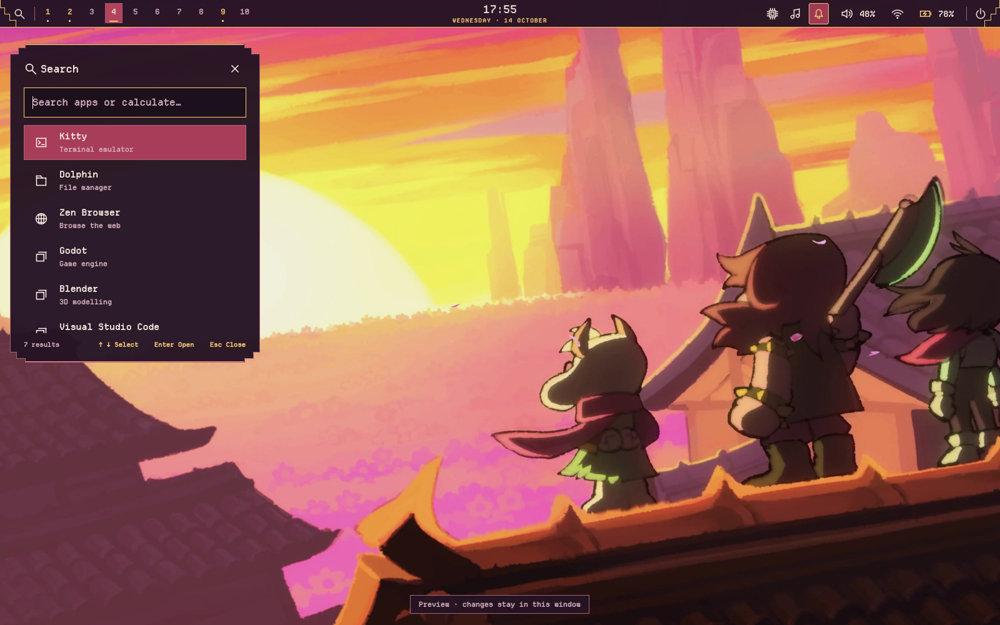

# Deltarune · Adventure — 0.1.0

Dördüncü bağımsız paket: `deltarune-adventure`, ABI `mct-shell-2.9`.
Kullanıcının Chapter 5 trailer olarak tanımladığı gün batımı/üçlü görseline ve
`design/deltarune/adventure-reference.png` konseptine dayanır. Sahne açıklaması
kullanıcı bağlamıdır; bağımsız oyun/lore doğrulaması yapılmadı.



Mürdüm yüzeyler, sıcak kırık beyaz metin, mercan seçimler, gün batımı altını.
Çatı saçaklarından alınan basamaklı panel/bar köşeleri ve çift hatlı SVG köşeler,
Departure Mono ve özgün CP437 gün batımı/çatı terminal süsü kullanılır.
Launcher solda; medya, controls ve bildirim geçmişi sağda. CenterPanels tercihi
önceliklidir. Ortak servisler, hesaplama, Alt+Tab, OSD, tray, ayarlar ve kısayollar
aynı yüzey/controller kaynaklarını kullanır; işlevli kod tema içine kopyalanmaz.

## Uygulama

Kurulu 2.9.0 ortak kaynak üstüne bu dalı almak yeterli; `update.sh` gerekmez.

```bash
bash preview.sh deltarune-adventure
bash theme.sh check deltarune-adventure && bash theme.sh apply deltarune-adventure
```

Super+G çizgisinde Adventure kartı görünür. Hover, tek seçim, arka plan kontrolü
ve geri alma mevcut çekirdeği kullanır. `bash theme.sh rollback` son geçişi geri
alır. Kişisel tercihler, monitör/GPU/giriş ayarları ve ilk restore yedeği korunur.

## Wallpaper

Sağlanan 2048×1152 JPEG değiştirilmeden `wallpaper-source.jpeg` içinde korunur.
3200×1800 RGB PNG, Lanczos ölçeklemedir: **Real-ESRGAN veya yapay yeni detay yok**.
Renk değiştirme, ek keskinleştirme ve kaynak kırpma uygulanmaz. 16:10 ekranı dolduran
mevcut compositor davranışı kenarlardan kırpabilir. Dört wallpaper kopyası aynı
pikselleri kullanır. Boyut/yöntem/hash kaydı `restoration.json` içindedir.
AI konsepti ile gerçek QML preview birbirinden ayrıdır.

## Ayrı uygulama uyarlamaları

Shell apply wallpaper, Hyprland görünümü, Kitty ve Hyprlock kaynaklarını değiştirir.
Dolphin/Spotify/SDDM/terminal süsü hâlâ ayrı kuruculardır. Uygulamaları kapatıp:

```bash
bash apps/install.sh dolphin --theme deltarune-adventure --check &&
bash apps/install.sh dolphin --theme deltarune-adventure
bash apps/install.sh spotify --theme deltarune-adventure --check &&
bash apps/install.sh spotify --theme deltarune-adventure
bash terminal-medallion/install.sh --theme deltarune-adventure --check &&
bash terminal-medallion/install.sh --theme deltarune-adventure
```

Dolphin normal/seçili metni beyaz, Spotify özel istemci/adblock başlatıcısı ve
ilk adaptör yedekleri korunur. Giriş ekranı için:

```bash
bash sddm/preview.sh --theme deltarune-adventure
sudo bash sddm/install.sh --theme deltarune-adventure --check &&
sudo bash sddm/install.sh --theme deltarune-adventure
```

Hazırlama doğrulaması offscreen/mock kapsamındadır; gerçek cihazda görünüm,
Wayland, PAM ve açık uygulamalar ayrıca denenir. [Karar](decisions/0018-adventure-theme.md).
