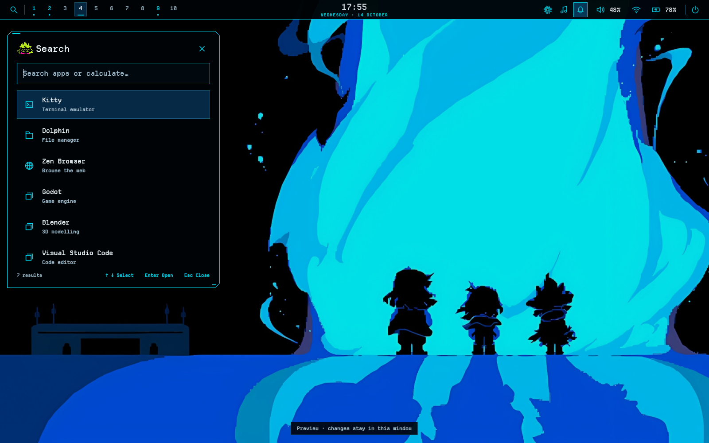

# Deltarune — ilk kullanım denemesi (2.8.0)

18 Ekim 2026: kullanıcının seçtiği arka plan ve onayladığı son referans temel
alındı. Bu, son kabul edilmiş ikinci tema değil; kullanıp revize edilecek sürüm.



## Önce pencerede bakmak

```bash
bash preview.sh deltarune
```

Kurulumu değiştirmez. Demo uygulama/sensör/medya verileri gösterir; panel düğmeleri,
hesaplama ve OSD önizlemede denenebilir. Gerçek uygulama veya oturum eylemi yapmaz.

## Canlı masaüstünde denemek

Mevcut dalında daha önce `theme.sh apply` ile bir paket etkinleştirdiysen, **dal
değiştirmeden önce** `bash theme.sh status` kontrol et ve `bash theme.sh rollback`
ile active null olana kadar kayıtlı geçişleri geri al. Yeni ABI'de eski canlı
ortak dosyalar eşleşmeyeceğinden bu işlem eski dalda yapılmalı. İlk install/restore
yedeği silinmez. Paket etkinleştirmediysen bu hazırlık adımı gerekmez.

```bash
git fetch origin feature/deltarune
git switch feature/deltarune
bash update.sh --check && bash update.sh
bash theme.sh check deltarune && bash theme.sh apply deltarune
```

Mevcut yerel `feature/deltarune` dalın varsa normal fast-forward güncelleme kullan;
yerel değişiklikleri silme. İlk kez MCT kuruyorsan update yerine mevcut install
akışı gerekir. Tema komutunu normal masaüstü kullanıcınla, sudo olmadan çalıştır.

Son geçişten önceki görünüme dönmek:

```bash
bash theme.sh rollback --check && bash theme.sh rollback
```

Başka bir kayıtlı temaya doğrudan geçmek de mümkün:

```bash
bash theme.sh check plague-tale && bash theme.sh apply plague-tale
```

## Bu denemede neler var?

- Seçilen görselin piksel eşitliği korunmuş PNG kopyası; yeniden çizim yok.
- Siyah/camgöbeği kesik köşeler, Departure Mono fontu, gerçek oyun menü portreleri.
- Mevcut bütün shell menüleri, Alt+Tab, bildirimler, ayarlar ve sürüklenebilir OSD.
- Solda launcher/yan paneller. Merkez panel tercihin açıksa öncelik ona aittir.
- Alt şerit: CPU sıcaklığı/yük, ses/mute, pil/şarj. SYSTEM donanımı, AUDIO/POWER
  kontrol panelini açar. Ekran başına 80 mantıksal piksel alan ayırır.
- Kitty renkleri ve Hyprlock medya renk/düğmeleri. Terminal başlangıcı değiştirilmez.

Super+R tekrar basınca kapanır. Super+M oturum menüsü, Super+T donanım,
Super+B bildirimler, Alt+Tab pencere seçimi aynı kalır. Yeni global kısayol yok.

Bu ilk paket SDDM, Dolphin, Spotify veya terminal madalyonuna Deltarune adaptörü
kurmaz. Hyprlock parola/saat sunumu da önceki ortak kurulumdadır. Bu alanlar
ikinci temanın sonraki revizyonları; bunların tamamlandığı iddia edilmez.

Sensör okuma bu temada iki saniyede bir devam eder; mevcut uyuyan GPU koruması
korunur. Sensör/pil/aygıt yoksa uydurma değer yerine TEMP — / AC / OFFLINE görünür.

## Önizlemeler ve sınır

[Medya](../previews/deltarune/media.png) · [OSD](../previews/deltarune/osd.png) ·
[Alt+Tab](../previews/deltarune/switcher.png). Bunlar Qt 6.10.2 DemoContext
render'larıdır; gerçek Wayland, Steam, PAM, Spotify veya fiziksel sensör kabulü
değildir. Fotoğraflı tema kartı için gerçek render metadata'ya kaydedildi;
tema menüsünün yeri hâlâ kullanıcı kararını bekliyor.


### Update başarılı, sürüm gate hatası aldıysan

18 Ekim düzeltmesi theme-core'un güncelleyiciden farklı olan tam 0.3.1 kilidini
aynı minimum >=0.3.1 kuralıyla değiştirir. `feature/deltarune` dalında:

```bash
git pull --ff-only
bash theme.sh check deltarune && bash theme.sh apply deltarune
```

Başarılı source update'i tekrarlamak veya restore çalıştırmak gerekmez. Gerçek
sürüm okunamazsa hata artık elde edilen çıktıyı da gösterir. Kullanıcının bu
logdaki kesin QuickShell sürümü bilinmiyor; yeni sürümde native kabul bekliyor.
