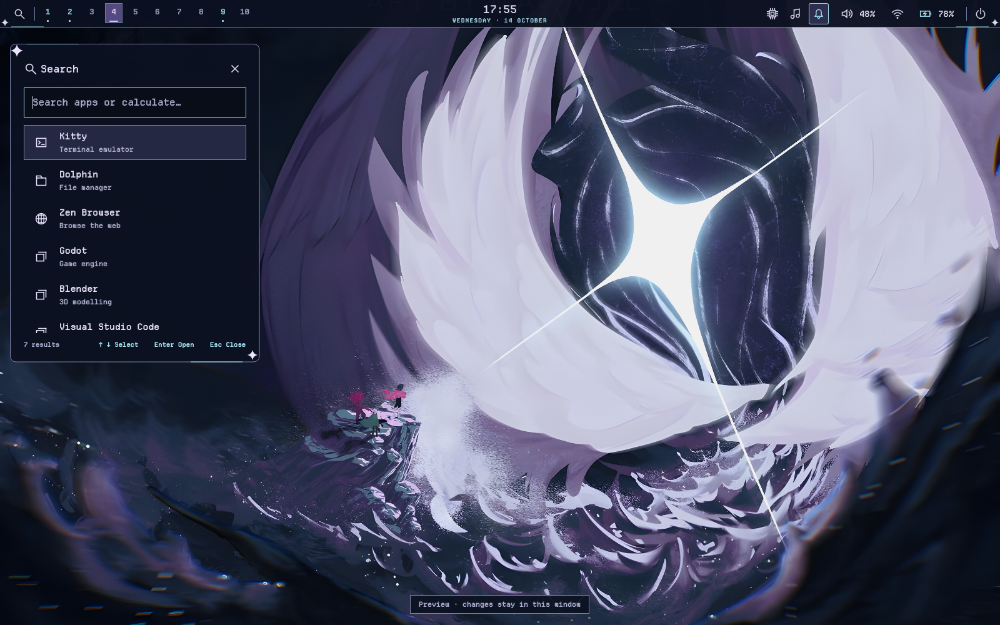

# Deltarune · Guardian — 0.1.1

Bağımsız paket: `deltarune-guardian`, ABI `mct-shell-2.9`.
Kullanıcının Chapter 4 Guardian savaşı olarak tanımladığı kaynak ve onaylı
`design/deltarune/guardian-reference.png` konseptine dayanır. Kaynak üstündeki
“ART BY MANVJLL” sanatçı yazısı korunur; ayrıca kaynak/lisans doğrulaması yapılmadı.



Gece laciverti yüzeyler, lavanta beyazı metin, buz mavisi vurgu ve yumuşak mor
seçimler. İnce yuvarlak çerçeveler ve dört uçlu yıldız/ışık çizimleri panel/bar,
SVG köşeler, klasör ikonları ve özgün CP437 halo/ışık terminal süsüne taşınır.
Launcher solda; controls, medya ve bildirim geçmişi sağda. CenterPanels tercihi
öncelikli. Ortak servis, kısayol, hesaplama, Alt+Tab, OSD/tray ve ayarlar değişmez.

## Kaynak ek paketini al

`MCT-guardian-0.1.0.zip` içindeki `import_guardian.py` yalnız kaynakları ekler;
masaüstünü, uygulamaları veya oturumu başlatmaz/değiştirmez. Mevcut Git dalını ve
Adventure dahil diğer temaları korur. Yeni `themes/deltarune-guardian/`, bu rehber,
adapter_assets.THEMES kaydı ve terminal vurgu kaydı eklenir. Seçicide görünmeyen kartlara klavyeyle erişim için revealSelection düzeltmesi de
eklenir. Üç kaynak dosyasının önceki hali indirdiğin paket içindeki `source-backups/` altında saklanır.

```bash
unzip -o ~/Downloads/MCT-guardian-0.1.0.zip -d ~/Downloads &&
python3 ~/Downloads/MCT-guardian-0.1.0/import_guardian.py ~/newfolder/desktop-style &&
cd ~/newfolder/desktop-style &&
bash theme.sh check deltarune-guardian &&
bash theme.sh apply deltarune-guardian
```

İçe aktarma aynı kaynakla tekrar çalıştırılabilir; farklı mevcut Guardian dosyaları
üzerine yazmaz. Paket SHA256/bütünlük kontrolü yapar; bir kayıt hatası oluşursa
kendi eklediklerini geri alır. Source import Git çalışma ağacında değişikliktir;
`git status` ile gözden geçirip mevcut dalında commit edebilirsin. Dal değiştirmek,
`update.sh` veya eski temayı geri almak gerekmez. Normal `preview.sh` de desteklenir:

```bash
bash preview.sh deltarune-guardian
```

Super+G çizgisinde Guardian kartı görünür. Hover ve tek seçim mevcut core'u
kullanır. Son geçişi `bash theme.sh rollback` geri alır; ilk masaüstü yedeğine
restore yapmaz. Yarım geçiş hatası görülürse seçiciyi kapatıp
`bash theme.sh recover` çalıştır; durum dosyalarını elle silme.

## Görseller ve sınırlar

1200×781 orijinal JPEG değiştirilmeden saklanır. **0.1.1: 4800×3124 RGB PNG**,
resmi RealESRGAN_x4plus modeliyle 4× neural restorasyondur; sanatçının native yüksek
çözünürlüklü kaynağı değildir. Önceki 0.1.0 yalnız 3× Lanczos ölçeklemeydi.
Renk değiştirme, ek keskinleştirme, kırpma veya sanatçı yazısını kaldırma uygulanmaz.
Dört runtime kopyası aynı PNG'yi kullanır. Model/source/output hash'leri ve işlem
parametreleri `restoration.json` içinde tutulur.

## Mevcut Guardian'ı 0.1.1'e güncelle

0.1.0 kaynağını yukarıdaki ek paketle kurduktan sonra yalnız görsel güncellemesini
uygula. Güncelleyici wallpaper kopyaları, preview, manifest, restoration.json ve bu
rehberi değiştirir. Palet, QML düzeni, diğer temalar ve orijinal JPEG korunur.
Değiştirilmiş hedef varsa önce durur; önceki dosyalar paket içindeki source-backups
altına alınır ve hata durumunda geri yüklenir. Aynı güncelleme tekrar çalıştırılabilir.

```bash
unzip -o ~/Downloads/MCT-guardian-0.1.1.zip -d ~/Downloads &&
python3 ~/Downloads/MCT-guardian-0.1.1/update_wallpaper.py ~/newfolder/desktop-style &&
cd ~/newfolder/desktop-style &&
bash theme.sh check deltarune-guardian &&
bash theme.sh apply deltarune-guardian
```

Sürüm 0.1.1 olduğu için zaten Guardian aktifken de yeni görsel uygulanır. SDDM ayrı
kurucudur; yeni görseli giriş ekranına almak için aşağıdaki SDDM adımını tekrarla.

## Ayrı uygulamalar

Shell apply wallpaper, Hyprland görünümü, Kitty ve Hyprlock kaynaklarını değiştirir.
Dolphin/Spotify/SDDM/terminal süsü ayrı kuruculardır. Uygulamaları kapattıktan sonra:

```bash
bash apps/install.sh dolphin --theme deltarune-guardian --check &&
bash apps/install.sh dolphin --theme deltarune-guardian
bash apps/install.sh spotify --theme deltarune-guardian --check &&
bash apps/install.sh spotify --theme deltarune-guardian
bash terminal-medallion/install.sh --theme deltarune-guardian --check &&
bash terminal-medallion/install.sh --theme deltarune-guardian
```

Dolphin normal/seçili yazıları beyazdır. Spotify özel istemci/adblock başlatıcısı,
uygulama ayarları ve ilk adaptör yedekleri korunur. Giriş ekranı:

```bash
bash sddm/preview.sh --theme deltarune-guardian
sudo bash sddm/install.sh --theme deltarune-guardian --check &&
sudo bash sddm/install.sh --theme deltarune-guardian
```

Gerçek cihazdaki görünüm/kullanım kabulü yeni Guardian paketi için beklenir.
Hazırlama Qt/mock testleri native Wayland, PAM veya gerçek uygulama testi değildir.
