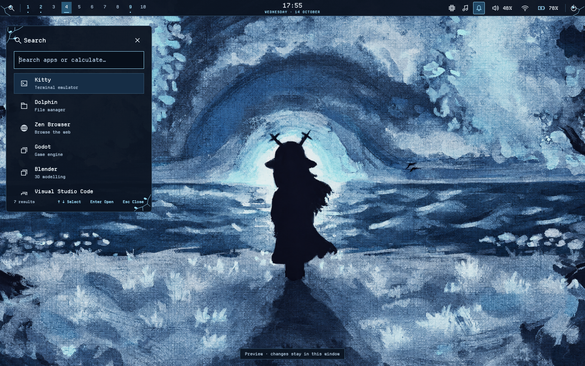

<!-- snowgrave-frost-0.2.0 -->
# Snowgrave Frost 0.2.0 — 20 Ekim 2026

19:47 Europe/Riga kullanıcı onayı: buz mavisi duvar kâğıdını, son koyu Noelle
silüetli büyük Proceed Fastfetch tasarımını kullan; renk şemasını yeniden yap.

0.1.0'ın sıcak sonbahar paleti bu sürümde değiştirilir. Koyu yüzey #0b1421,
yükseltilmiş yüzey #162d45, metin #edf7ff, ikincil metin #9fb8d0, vurgu
#9cdfff, çerçeve #365873 ve seçim #224c6b. Hata/uyarılar ayırt edilebilir
soğuk gül tonundadır; dekorlar buz mavisidir. Dolphin normal/seçili metni beyaz.

Duvar kâğıdı, shell varlığı, Hyprlock cover ve SDDM wallpaper aynı onaylı dosya.
Kitty ANSI renkleri, Hyprland sınırları, shell Theme.qml ve SVG dekorlar,
Hyprlock layout/media/SVG'den üretilen kontroller, Dolphin KDE/Qt paleti ve
klasör ikonları, Spotify INI/CSS ve SDDM LoginSkin aynı palete geçirilir.

Fastfetch'te son onaylanan silüet PNG'si yeniden renklendirilmez; normal
50×25 / compact 40×20 hücre. Forgotten Man ve diğer üç tema değiştirilmez.
Ortak işlev/controller, kısayol, kullanıcı tercihi ve ilk restore yedeği değişmez.

Paket ABI mct-shell-2.9 olarak kalır; yalnız Snowgrave manifesti 0.2.0 olur.
SDDM sync cache, yeni fingerprint için mevcut kurucuyla yenilenir. Display
manager restart veya oturum kapatma yapılmaz. Apply/journal/undo mevcut çekirdektir.
Native Wayland/Fastfetch, gerçek Spotify/Dolphin, PAM veya sonraki giriş bu
hazırlama ortamında doğrulanmış sayılmaz; kullanıcıdaki son görünüm kontrolü bekler.


# Deltarune · Snowgrave — 0.1.0

Üçüncü bağımsız tema paketi: `deltarune-snowgrave`, ABI `mct-shell-2.9`.
Kullanıcının sonbahar ormanı/boynuzlu silüet referansına dayanır. Sahneye kar,
buz veya yeni karakter eklenmez; Snowgrave/Chapter bağlamı kullanıcının açıklamasıdır.



Koyu umber yüzeyler, kırık beyaz yazılar, soluk altın konturlar ve pas kırmızısı
seçimler. Yuvarlatılmış ince dal/yaprak köşeleri, Departure Mono, kompakt sol
launcher; controls, medya ve bildirim geçmişi sağda. CenterPanels tercihi öncelikli.
Alt şerit yok; hiçbir oyun/tema markası shell panellerine eklenmez.

Bütün servisler, kısayollar, hesaplama, Alt+Tab, tray, OSD, bildirim ve ayar
etkileşimleri ortak şablonlardan gelir. Tema içine işlev kopyalanmaz.
Kullanıcı tercihleri, ilk restore yedeği ve monitör/GPU/input ayarları korunur.

## Kurmadan incele / uygula

Kurulu ortak kaynak 2.9.0 üstüne bu paketin kaynaklarını almak yeterli;
`update.sh`, masaüstü restore veya önce eski temayı rollback etmek gerekmez.

```bash
bash preview.sh deltarune-snowgrave
bash theme.sh check deltarune-snowgrave && bash theme.sh apply deltarune-snowgrave
```

Super+G fotoğraflı tema çizgisinde de üçüncü kart görünür. Hover/tek seçim,
arka plan kontrolü, hata/rollback ve klavye gezinmesi mevcut çekirdeği kullanır.
Katalog kartının rengi ve fontu artık kimlik adına göre değil doğrulanmış
Theme.qml/varlık envanterinden okunur; Plague Tale ve Deltarune kartları korunur.

Geri dönüş için çizgiden başka temayı seçebilir veya `bash theme.sh rollback`
kullanabilirsin. Bu komut son tema geçişini geri alır; ilk masaüstü restore değildir.

## Wallpaper ve diğer yüzeyler

Orijinal kullanıcı JPEG'i (1200×675) değiştirilmeden paket içinde saklanır.
Resmi RealESRGAN_x4plus ile 4× restore edilip paket sınırına uygun yüksek
çözünürlüklü **3600×2025 PNG**'ye indirgenir. Aşırı belirginleşen tuval dokusu
%40 restorasyon/%60 orijinal Lanczos harmanıyla yumuşatıldı. Bu, sanatçının native yüksek çözünürlüklü kaynağı
olarak sunulmaz. Boyut/model/hash ve işlem parametreleri
[restoration.json](../themes/deltarune-snowgrave/restoration.json) içindedir.

Shell apply wallpaper, shell, Hyprland görünümü, Kitty ve sonraki Hyprlock
kaynaklarını değiştirir. Diğer uyarlamalar **ayrı kuruculardır**; açık uygulamaları
kendiliğinden kapatmaz veya SDDM'yi otomatik kurmaz. Dolphin'in normal/seçili yazısı
beyaz kalır; Spotify'ın özel istemci/adblock başlatıcısı aynı kurucuyla korunur.

Uygulamaları kapattıktan sonra:

```bash
bash apps/install.sh dolphin --theme deltarune-snowgrave --check
bash apps/install.sh dolphin --theme deltarune-snowgrave
bash apps/install.sh spotify --theme deltarune-snowgrave --check
bash apps/install.sh spotify --theme deltarune-snowgrave
```

Diğer kaynaklar:

```bash
bash sddm/preview.sh --theme deltarune-snowgrave
sudo bash sddm/install.sh --theme deltarune-snowgrave --check
sudo bash sddm/install.sh --theme deltarune-snowgrave
bash terminal-medallion/install.sh --theme deltarune-snowgrave --check
bash terminal-medallion/install.sh --theme deltarune-snowgrave
```

CP437 terminal süsü ağaç yerine kemer/boynuzlu silüettir. Kurucular ilk yedeği
korur; SDDM preview gerçek PAM/giriş testi değildir. Yeni temanın gerçek cihazdaki
son görünüm/kullanım kabulü beklenir. [Karar](decisions/0017-snowgrave-theme.md).
